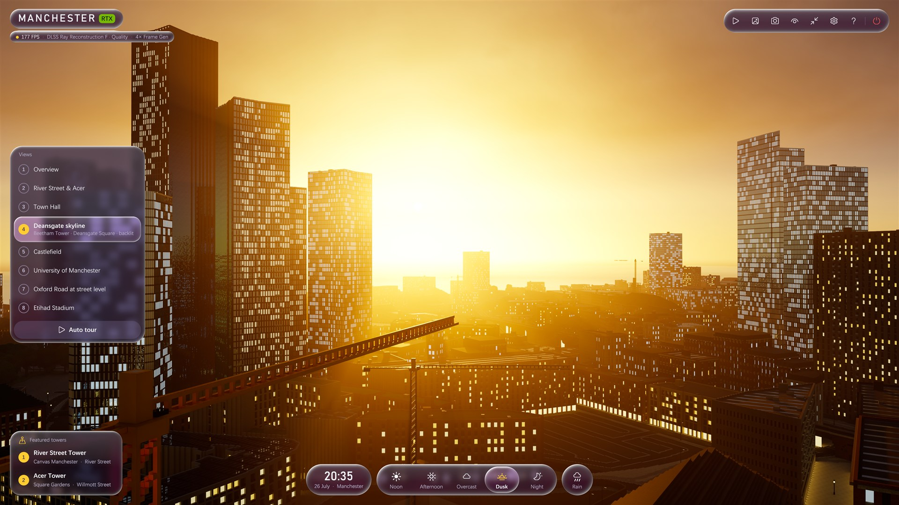
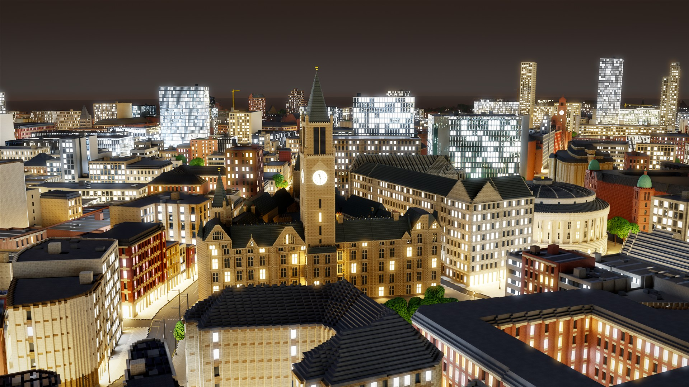
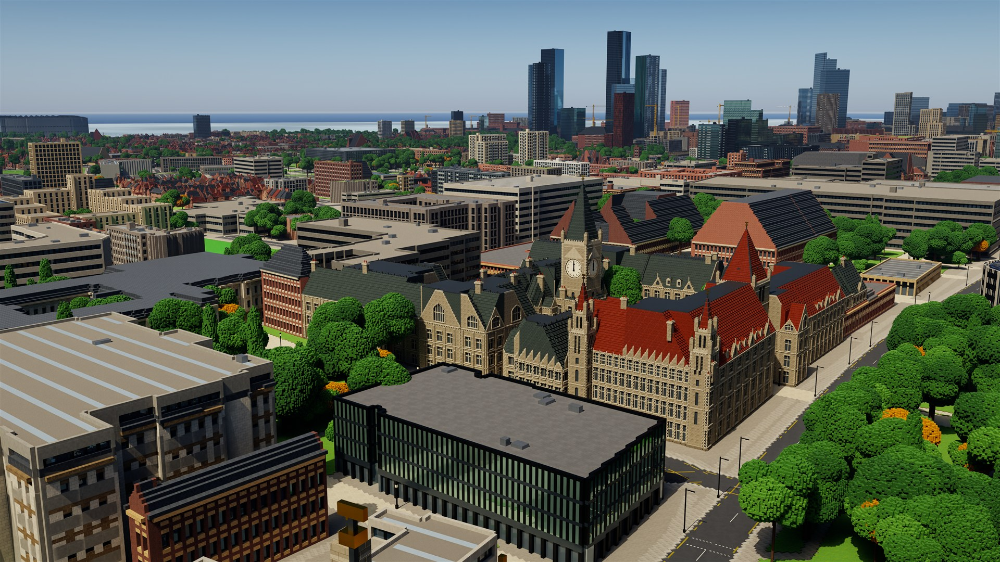
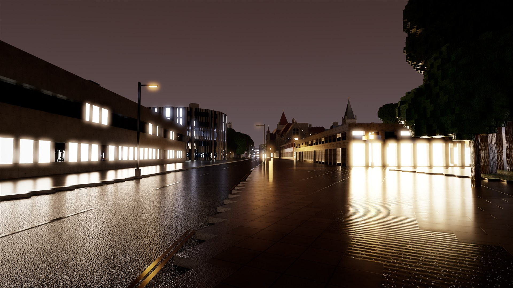
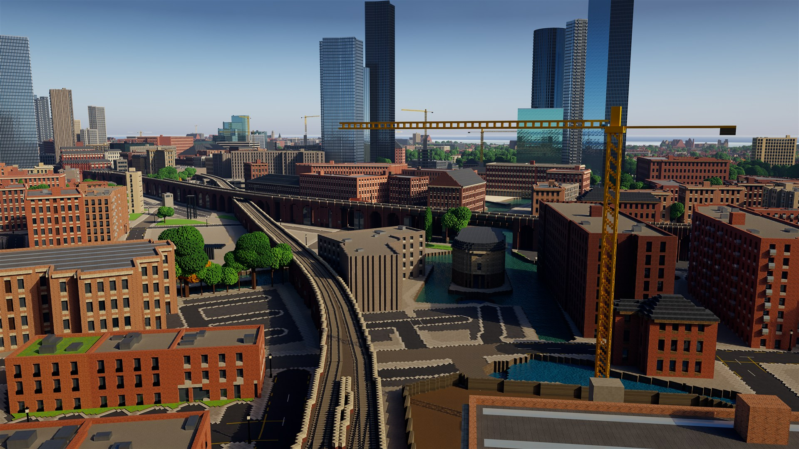
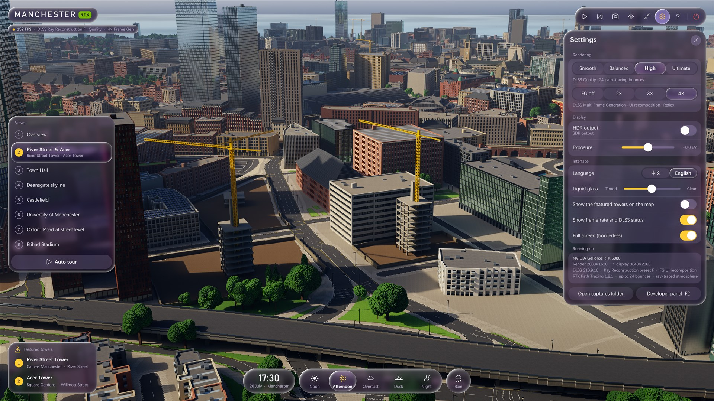
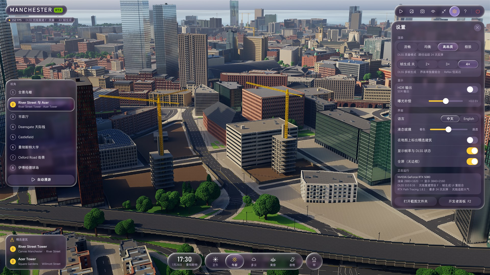

# Manchester RTX



**曼彻斯特城区的实时路径追踪模型。** 城市按真实尺度由 OpenStreetMap 生成，用 NVIDIA RTX Path Tracing、DLSS 4 光线重建与多帧生成渲染。五个时刻的太阳都沿曼彻斯特的真实轨迹运行，另有雨天、光线追踪大气与 HDR10 输出。界面为液态玻璃风格，支持中文和英文。

[English](README.md) · [下载 Windows 版](https://github.com/ShoWTimETheKey/ManchesterRTX/releases/latest) · [技术说明](docs/notes.zh-CN.md)

> 个人爱好项目，与 NVIDIA、曼彻斯特大学、曼彻斯特市政府均无关联，也未获其认可。

## 亮点

- **1:1 的城市。** 约 2.6 km × 3.2 km，北起 Victoria，南至 Whitworth Park，西起 Salford，东至 Ancoats。7600 栋建筑按 OSM 轮廓与高度生成为 0.6 m 体素，立面风格按标签和街区选择：维多利亚仓库、红砖联排、玻璃幕墙、石砌商业楼等。此外还有：
  - 1.5 万条带路缘和标线的街道；
  - 铁路与 Metrolink 高架、运河与河流；
  - 4400 盏路灯、6900 棵树和 28 台塔吊。
- **精细地标**（0.16–0.3 m），例如：
  - 市政厅：四面钟始终显示画面对应的时刻；
  - 曼彻斯特大学 Old Quad：Oxford Road 门楼上方有鎏金字 **UNIVERSITY OF MANCHESTER**；
  - 中央图书馆、约翰·赖兰兹图书馆、大教堂、米德兰酒店、Kimpton Clocktower；
  - 伊蒂哈德球场与老特拉福德，各放在桌边的小台座上。
- **路径追踪。** [RTX Path Tracing](https://github.com/NVIDIA-RTX/RTXPT) 1.8.1，配合：
  - DLSS 光线重建（Transformer 预设 F）；
  - 超分辨率或 DLAA；
  - 最高 4× 多帧生成，带界面重组合与 Reflex（Streamline 2.14.16，DLSS 310.9.16）。
- **时间与天气。** 正午、午后、多云、黄昏、夜晚，都在 7 月 26 日，太阳沿曼彻斯特的真实轨迹运行。切换时是一段 2–5 秒的延时摄影：时钟、太阳、云、雾霭、窗灯与路灯、湿润的路面、钟楼指针一起过渡。随时可以切换晴雨。
- **光线追踪大气。** 包括：
  - 被城市几何切出的光柱；
  - 高度雾与空气透视；
  - 随天上云朵飘移的云影；
  - 夜晚的星空。
- **HDR10。** 色调曲线滚降到显示器报告的峰值亮度，白色亮度跟随 Windows 的“SDR 内容亮度”。
- **液态玻璃界面。** 采用曼彻斯特大学的紫色与金色，支持中文 / English。包括：
  - 视角侧栏；
  - 带实时时钟的天气坞；
  - 设置面板；
  - 照片模式：镜头静止时累积出无噪点的参考级画面。

| | |
|---|---|
|  |  |
| 夜晚的市政厅与 Albert Square | 正午的曼彻斯特大学 Old Quad |
|  |  |
| 雨夜，人眼高度的 Oxford Road | 午后的 Castlefield 高架 |
|  |  |
| 英文界面 | 中文界面 |

## 配置要求

- Windows 10 / 11（64 位）。
- NVIDIA GeForce RTX 显卡与较新的驱动。帧生成需要 RTX 40 系列，多帧生成（3×、4×）需要 RTX 50 系列。
- 4K 下建议 12 GB 以上显存（实测占用约 9.5 GB）。
- 约 3 GB 磁盘空间。

实测 RTX 5080、4K、高画质、4× 帧生成时，各视角约 155–200 FPS。

## 运行

1. 从 [Releases](https://github.com/ShoWTimETheKey/ManchesterRTX/releases/latest) 下载 `ManchesterRTX-…-win64.zip` 并解压。
2. 双击 **`ManchesterRTX.exe`**，约 20 秒后城市出现。

设置（包括语言）保存在 `renderer\bin\ManchesterRTX.ini`。语言默认跟随 Windows，可在 **设置 → 界面 → 语言** 中切换。

| 操作 | 作用 | 按键 | 作用 |
|---|---|---|---|
| W A S D | 移动 | 1 – 8 | 飞往视角 |
| Q / E | 下降 / 上升 | Shift + 1 – 5 | 切换时间与天气 |
| Shift / Ctrl | 加速 / 减速 | R | 晴 / 雨 |
| 左键拖动 | 环顾 | T | 自动漫游 |
| 右键拖动 | 平移 | P | 照片模式 |
| 中键拖动、Alt + 左键拖动 | 环绕 | F12 | 截图（保存到 `captures\`） |
| 滚轮 | 推近 / 拉远 | H | 隐藏 / 显示界面 |
| 点击地标 | 飞往该楼 | F11 | 全屏 / 窗口 |
| F1 | 操作说明 | Esc | 关闭面板 / 退出 |

## 从源码编译

需要：
- Visual Studio 2022 或更新版本（含“使用 C++ 的桌面开发”，自带 CMake 即可）；
- Git 与 Git LFS；
- Node.js 20 或更新版本；
- 约 25 GB 磁盘空间。

```powershell
git clone https://github.com/ShoWTimETheKey/ManchesterRTX.git
cd ManchesterRTX
.\setup.ps1
```

`setup.ps1` 会做这几件事：
- 把 [RTXPT](https://github.com/NVIDIA-RTX/RTXPT) 1.8.1（本项目基于的提交）及其子模块和示例资源克隆到 `renderer\`；
- 应用 `rtxpt\patches\` 中的补丁，并把曼彻斯特模块（`rtxpt\Manchester\`）与应用数据（`rtxpt\assets\`）复制进去；
- 配置并编译渲染器（Streamline 2.14.16 由 CMake 自动下载）；
- 编译启动器。

然后从 `data\osm\` 里的 OpenStreetMap 数据生成城市。约需 1 分钟，生成 1.4 GB 的 `renderer\Assets\Models\Manchester\manchester.glb`：

```powershell
node --max-old-space-size=16000 exporter\export2.mjs
```

也可以用 `.\setup.ps1 -Model release` 直接取用最新发布版里的模型。

| 路径 | 内容 |
|---|---|
| `exporter\` | 城市生成器（Node.js，无第三方依赖）：<br>• `export2.mjs` 为入口；<br>• `city2\` 包含地面、建筑、高架与轨道、街道设施、哥特式与古典地标、塔楼与球场、钟面、立体字和 glTF 写出；<br>• `gui-text.mjs` 存放界面的中英文名称 |
| `rtxpt\Manchester\` | 嵌在 RTXPT 中的应用：<br>• 界面（`ManchesterApp`）；<br>• 液态玻璃（`ManchesterUILayer`、`LiquidGlass.hlsl`）；<br>• 光线追踪大气（`ManchesterAtmosphere`、`Atmosphere.hlsl`） |
| `rtxpt\patches\` | 对 RTXPT 与 Donut 的修改：<br>• 应用模式与 HDR10 输出；<br>• 程序化天空与色调映射；<br>• Streamline 2.14 与 DLSS-G 界面重组合；<br>• 预乘透明度的 ImGui；<br>• 帧时间平滑与开发者录制 |
| `launcher\` | `ManchesterRTX.exe`：中英双语的启动画面，负责启动渲染器并把焦点交给它 |
| `data\osm\` | 生成模型所用的 OpenStreetMap 数据及其 Overpass 查询 |
| `tools\` | 截图、预览、字形表、启动画面、HDR 检查、闪烁与帧节奏测量等脚本 |
| `docs\` | 图片与详细的技术说明 |

## 许可与致谢

- 本项目自己的代码（生成器、启动器、曼彻斯特模块、工具）采用 [MIT 许可](LICENSE)。
- **RTX Path Tracing** 及 `rtxpt\patches\` 中对它的修改遵循 NVIDIA RTX SDKs 许可。*This software contains source code provided by NVIDIA Corporation.* Donut 为 MIT 许可。发布包中的 DLSS 与 Streamline 二进制文件按 NVIDIA 的条款再分发。
- **地图数据** © [OpenStreetMap](https://www.openstreetmap.org/copyright) 贡献者，采用开放数据库许可（ODbL）。
- 完整列表见 [THIRD_PARTY_NOTICES.md](THIRD_PARTY_NOTICES.md)。
